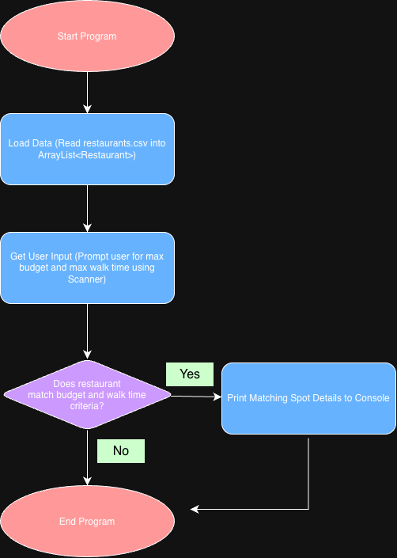

# Late-Night Food Finder
A Java console application that helps Purdue students quickly locate late-night campus food spots based on budget, walking distance, and dietary preferences.

## The Problem
When studying late on campus, students (including me) often struggle to find open food options that fit a tight budget, a short walk in the cold, and specific dietary needs (like Vegetarian or Halal) all at once. This tool solves that by filtering local late-night spots against all three constraints in seconds.

## How It Works
The application separates data, filtering logic, and user interaction across four Java classes:
* **`FoodSpot.java`**: Models a restaurant with its name, average price, walking time, closing time, and dietary tag.
* **`FoodRepository.java`**: Stores and supplies the dataset of campus food spots *(updated from the initial `restaurants.csv` plan to an in-memory repository for a self-contained MVP)*.
* **`FoodFilter.java`**: Filters the restaurant list using case-insensitive checks for max budget, max walk time, and dietary preference.
* **`Main.java`**: Handles terminal prompts via `Scanner` and prevents crashes on invalid input using `try-catch` loops.



## Tech Stack
* **Language:** Java
* **Data Storage:** In-memory Java collections (`ArrayList`, `List`)
* **Tools:** IntelliJ IDEA, Git, GitHub
* **Diagramming:** draw.io

## Setup & Installation
1. **Clone the repository:**
   ```bash
   git clone [https://github.com/diyamanikandan123/late-night-food-finder.git](https://github.com/diyamanikandan123/late-night-food-finder.git)
   cd late-night-food-finder

## Demo
[Video Walkthrough](https://drive.google.com/file/d/1hywib1rNnp8ucXODp1zhCE934sHL0akC/view?usp=drive_link)